<!-- Save this as README.md in a repo named exactly like your username: github.com/shatwiks/shatwiks -->

<div align="center">


<a href="https://git.io/typing-svg">
  
</a>

<br/>


<a href="https://www.linkedin.com/in/shatwik-sarthak-b6121b2a6/"></a>
<a href="mailto:shatwik7@gmail.com"></a>
<a href="https://github.com/shatwiks"></a>

</div>

---

## ⚡ About Me

B.Tech student in **Computer Science and Engineering at Manipal Institute of Technology (MIT) Bengaluru** (2024 to 2028).
I build systems that stay correct under load: atomic inventory gates, real-time sync, streaming ingestion, and retrieval pipelines that are measured rather than guessed.

- 🏆 **Tech Solstice 48-Hour National Hackathon** finalist, Top 5 of 120+ teams
- ⚙️ Focus: scalable distributed web architectures (Node.js, TypeScript, PostgreSQL, Redis) plus production AI/ML systems (Advanced RAG, model serving, agent workflows)
- 🚀 Building **PolyPulse**, a C++20 + ClickHouse prediction-market orderbook and markout pipeline
- 🎯 Preparing for entry-level SDE and Full-Stack AI/ML roles

---

## 🛠️ Tech Stack

<div align="center">

**Languages & Frontend**


**Backend & Databases**


**Cloud, DevOps & AI**


<br/>


</div>

| Domain | Details |
| :--- | :--- |
| **Distributed Systems** | Redis (Lua scripting, Redlock, Pub/Sub, semantic caching), Saga pattern, idempotency keys, TOCTOU race-condition elimination, eventual consistency, microservices |
| **Data Pipelines & Streaming** | WebSocket ingestion, deduplication and replay recovery, dead-letter handling, ClickHouse materialized views and ASOF joins, SSE |
| **AI & ML** | RAG, agentic AI, prompt engineering, dense embeddings, Cohere Rerank, Ragas, DeepEval |
| **Testing & Practices** | PyTest, Jest, k6 load testing, observability, Agile (Scrum, Kanban), conventional commits |
| **AI-Assisted Development** | GitHub Copilot, Claude Code, Cline, Aider |

---

## 📊 Top Skills (measured from my repos)

*Measured by non-blank lines of code and how many repos use each tool, across 10 public repositories (168k+ lines).*

**Languages**

```text
Python      ██████████████████░░░░░░░░░░░░░░░░░░░░░░  45.2%  · 76.2k lines · 6 repos
TypeScript  ████████████████░░░░░░░░░░░░░░░░░░░░░░░░  39.5%  · 66.7k lines · 9 repos
JavaScript  ████░░░░░░░░░░░░░░░░░░░░░░░░░░░░░░░░░░░░  11.1%  · 18.7k lines · 6 repos
CSS         █░░░░░░░░░░░░░░░░░░░░░░░░░░░░░░░░░░░░░░░   2.6%  ·  4.4k lines · 10 repos
C++20       █░░░░░░░░░░░░░░░░░░░░░░░░░░░░░░░░░░░░░░░   0.8%  ·  1.3k lines · orderbook engine
SQL         █░░░░░░░░░░░░░░░░░░░░░░░░░░░░░░░░░░░░░░░   0.7%  ·  1.2k lines · 8 repos
```

**Most-used frameworks & infrastructure** *(number of repos)*

| Frontend | Backend | Data & Infra |
| :--- | :--- | :--- |
| ⚛️ React · **9** | ⚡ FastAPI · **6** | 🐳 Docker · **9** |
| 🎨 Tailwind CSS · **6** | 🧱 SQLAlchemy + Pydantic · **5** | 🐘 PostgreSQL · **8** |
| ▲ Next.js · **5** | 🚂 Express · **4** | ⚙️ GitHub Actions CI · **6** *(+ profile)* |
| ⚡ Vite · **5** | 🛠️ Alembic · **4** | 🟥 Redis · **5** |
| 🧊 Three.js · **2** | 🧪 pytest · **4** *(+ Vitest · 2)* | 🧭 pgvector · **3** *(+ SQLite · 2)* |
| 🐻 Zustand · **2** | 🛡️ Zod · **3** *(+ Prisma · 2)* | ☸️ Terraform · **2** *(+ K8s · 1)* |

---

## 🚀 Featured Projects

*All 10 projects built across distributed systems, applied AI, cloud-native infrastructure, and full-stack engineering — ranked by systems depth and recruiter impact.*

### 1. [AegisOps — Autonomous AIOps & Self-Healing Kubernetes Control Plane](https://github.com/shatwiks/AegisOps)
Locally runnable AIOps control plane and Kubernetes operator that scrubs PII fail-closed (`1.00` precision/recall), maps CMDB blast radius, retrieves runbooks via `pgvector` + Ollama hybrid RAG, and either auto-heals safely, enforces Keycloak OIDC + TOTP MFA approval, or deterministically refuses unsafe remediation before verifying 60s of sustained recovery.
Verified end-to-end with **65/65** pytest tests (unit, live K8s/DB integration, Playwright E2E), **240/240** `k6` burst checks (`0%` errors), **4/4** live chaos scenarios, Ruff/Mypy clean across 50 Python modules, and GitHub Actions CI.
**Stack:** `Python` · `FastAPI` · `Kubernetes (kind)` · `Terraform` · `PostgreSQL + pgvector` · `Redis` · `Keycloak` · `Ollama` · `React / TypeScript`

### 2. [Bastion Hybrid RAG — Enterprise Multi-Tenant Knowledge Engine](https://github.com/shatwiks/Bastion-hybrid-rag)
Multi-tenant enterprise RAG platform that eliminates top-K permission leaks by injecting JWT `tenant_id` and `allowed_roles` directly into PostgreSQL `WHERE` clauses before `pgvector` HNSW + dual-FTS Reciprocal Rank Fusion, paired with a scoped Redis 8 semantic cache and a `MiniLM` cross-encoder refusal gate (`0` LLM tokens spent below `0.65`).
Benchmarked at **100.0% retrieval precision** and **1.0000 MRR** (+32.59% over dense baseline) across 28 probes, **0.0% ungrounded answers** across 14 adversarial traps, and **0.0% RBAC leakage**, backed by 22 unit/integration test suites and Docker Compose.
**Stack:** `Python` · `FastAPI` · `PostgreSQL 17 + pgvector` · `Redis 8` · `PyTorch / Cross-Encoder` · `LiteLLM / Ollama` · `Next.js 16` · `Docker`

### 3. [Distributed Flash-Sale & Cloud Checkout Engine](https://github.com/shatwiks/distributed-flash-sale-engine) • [Live Demo](https://distributed-flash-sale-engine-bj7q.vercel.app/)
High-contention ticket checkout engine engineered with an `O(1)` atomic Redis 7 Lua stock gate, Redlock distributed locking, two-tier idempotency keys, and Saga `INCRBY` rollbacks to keep Redis and PostgreSQL 16 consistent even during simulated DB crashes.
Benchmarked with `k6` at **10,000+ RPS** with **0.00% overbooking** and **93% lower p95 latency** (`271 ms → 18.5 ms`), shipped with an interactive Next.js 16 Duel Mode visualizer, Docker Compose, and AWS ECS Terraform IaC.
**Stack:** `Node.js` · `Express` · `Redis 7 (Lua)` · `PostgreSQL 16` · `Next.js 16` · `k6` · `Docker` · `AWS ECS / Terraform`

### 4. [PolyPulse — Cross-Venue Prediction-Market Orderbook & Markout Pipeline](https://github.com/shatwiks/polypulse)
Low-latency market-data and cross-venue arbitrage analytics pipeline bridging Polymarket and Kalshi with a cache-aligned **C++20** integer-tick orderbook (`extern "C"` FFI), self-healing WebSocket ingestion, SQLite WAL journaling, and ClickHouse materialized analytics (`p50 = 21–33 ms`) for 5s/30s/60s post-trade wallet markouts.
Implements depth-aware VWAP, official Polymarket & CFTC fee curves, and a React 19 Web Worker terminal; verified offline with **133 pytest tests**, C++20 unit assertions, TypeScript production builds, and GitHub Actions CI.
**Stack:** `C++20` · `Python AsyncIO` · `FastAPI` · `ClickHouse` · `SQLite WAL` · `React 19 / TypeScript` · `Docker`

### 5. [GlamGo — Multi-Vendor Beauty Marketplace & Booking Platform](https://github.com/shatwiks/Glamgo) • [Live Demo](https://glamgo-ricoz.vercel.app/) • [API Docs](https://glamgo-backend-lqn6.onrender.com/docs)
Production full-stack marketplace unifying at-home services, salon appointments, and multi-vendor beauty retail across 5 RBAC portals with deadlock-free `FOR UPDATE` stock reservations, server-authoritative Razorpay paise orders, HMAC-SHA256 webhook reconciliation, and append-only PostgreSQL audit triggers.
Cut live catalog API latency by **~7.3×** (`2.20s → 0.30s`, `−60.9%` wire bytes) via `selectinload`, 12 B-tree indexes, Redis/in-memory caching, GZip, and SWR hydration; verified by **62 pytest tests**, Playwright viewport audits, and 3-stage GitHub Actions CI.
**Stack:** `Python` · `FastAPI` · `PostgreSQL 16` · `SQLAlchemy / Alembic` · `Redis 7` · `Razorpay` · `Vite / JS` · `Docker`

### 6. [PayGuard AI — Agentic Payment Dispute Triage & RAG Engine](https://github.com/shatwiks/PayGuard-AI-Agentic-Payment-Triage-RAG-Engine)
Multi-agent payment exception and chargeback triage platform combining FastAPI agent orchestration, PostgreSQL 16 + `pgvector` hybrid retrieval (full-text + dense vectors with RRF), local Ollama (`nomic-embed-text`, `llama3.2`), and a Next.js 16 operations console with human-in-the-loop review gates.
Achieved **100% pass rate** on a 40-case RAG evaluation suite (Recall@5 `100%`, MRR `1.0`) with **207 automated test cases** across 20 test files, 8/8 Playwright E2E tests, strict multi-tenant IDOR isolation, and prompt-injection hardening.
**Stack:** `Python` · `FastAPI` · `PostgreSQL 16 + pgvector` · `Ollama` · `Redis` · `Next.js 16 / React 19` · `Docker`

### 7. [StockPulse — Multi-Tenant B2B Inventory & POS Order Engine](https://github.com/shatwiks/StockPulse-Multi-Tenant-Inventory-Order-Engine)
Multi-tenant B2B inventory and POS checkout engine that eliminates overselling and PostgreSQL `40P01` deadlocks using deterministic row-lock ordering (`SELECT ... FOR UPDATE ORDER BY id ASC`) and `stock_quantity >= 0` DB constraints across 3 isolated RBAC tiers.
Verified through 10-thread concurrent checkout stress tests (`0` negative-stock drift), **20/20** production-readiness items, WCAG 2.1 AA accessibility checks, an interactive Three.js 3D warehouse console, OpenAPI 3.0 docs, and GitHub Actions CI.
**Stack:** `TypeScript` · `Next.js 16 / React 19` · `Node.js / Express` · `PostgreSQL 16` · `Prisma` · `Three.js` · `Docker`

### 8. [RicozViz — Enterprise Multi-Tenant BI & DuckDB AI Analytics Platform](https://github.com/shatwiks/ric0fc)
Dual-storage SaaS analytics platform pairing PostgreSQL multi-tenant RBAC with an embedded **DuckDB** columnar query engine for sub-second OLAP exploration, a 6-chart drag-and-drop dashboard studio with 192-bit share tokens, and a schema-safe Google Gemini AI Analyst.
Hardened with **42/42** passing backend security/regression tests and **12/12** Playwright-verified pages (`0` console/network errors), with cloud deployment configured for Vercel, Render, and Supabase.
**Stack:** `TypeScript` · `Next.js 16` · `Python / FastAPI` · `DuckDB` · `PostgreSQL / Supabase` · `Google Gemini` · `Docker`

### 9. [OrderFlow — Real-Time Multi-Restaurant Commerce & Delivery Platform](https://github.com/shatwiks/Real-Time-Commerce-and-Web-Application-Platform) • [Live Demo](https://food-full-stack-kappa.vercel.app/)
Real-time food ordering and fulfillment engine featuring room-partitioned Socket.io order tracking (`order:<id>`, `restaurant:<id>`), database-authoritative ACID billing that rejects client price tampering, and step-up email 2FA OTP with atomic 3-attempt burn protection.
Ships with Vitest/Supertest suites (`auth-2fa`, `core-api`), Docker Compose, GitHub Actions CI, and live Vercel + Render deployment.
**Stack:** `TypeScript` · `React` · `Zustand` · `Node.js / Express` · `Socket.io` · `Prisma` · `PostgreSQL 15` · `Docker`

### 10. [MedicineLink — Verified Surplus Medicine Redistribution Platform](https://github.com/shatwiks/Medicine-Link)
Closed-loop healthcare prototype connecting donors, licensed pharmacists, and verified NGOs via Tesseract.js OCR blister-pack intake, a 12-factor clinical eligibility rules engine, Haversine-weighted geo-matching, and cryptographic QR delivery confirmation.
Built on native Node.js SQLite (`15` tables, strict `CHECK` constraints, append-only audit triggers, and partial unique concurrency indexes) with 4 persona portals, Swagger OpenAPI docs, and an automated Vitest suite.
**Stack:** `TypeScript` · `React 18 / Vite` · `Node.js / Express` · `SQLite (WAL)` · `Tesseract.js OCR` · `Vitest`

---

## 🏆 Hackathons & Achievements

**Team Lead & National Finalist, Tech Solstice 48-Hour Hackathon** • Bengaluru • March 2026 • *Top 5 of 120+ teams*

- Led the build of **DisasterSync**, an offline-first disaster coordination and reporting system, from concept to working product in 48 hours
- Local mesh synchronization with WebSockets, WebRTC and IndexedDB, auto-syncing stored telemetry to cloud PostgreSQL once connectivity returns
- Real-time status dashboards and automated alert triage for field teams

**Certifications & more**

- 🎓 Supervised Machine Learning: Regression and Classification (DeepLearning.AI / Coursera)
- 🎓 Generative AI, LLMs, RAG & Prompt Engineering Foundations
- 🧩 200+ DSA, OOP and SQL problems solved on LeetCode and HackerRank
- 🤝 Active contributor to campus coding and AI/ML societies at MIT Bengaluru

---

## 📊 GitHub Stats

<div align="center">



<br/>


<br/>


</div>

### 🧊 3D Contribution Graph

<div align="center">
  
</div>

### 🐍 Contribution Snake

<div align="center">
  <picture>
    <source media="(prefers-color-scheme: dark)" srcset="https://raw.githubusercontent.com/shatwiks/shatwiks/output/github-contribution-grid-snake-dark.svg" />
    
  </picture>
</div>

---

## 🧠 Engineering Principles

- **Systems over wrappers:** resilient background queues, distributed caches and streaming protocols instead of brittle synchronous API calls
- **Deterministic AI:** guarding non-deterministic LLM behavior with strict schema validation (Pydantic/Zod), context-precision scoring and automated hallucination tests in CI
- **Clean code & Git hygiene:** semantic commits (`feat:`, `fix:`, `refactor:`), READMEs with architecture diagrams, reproducible Docker configs

## 🎯 Currently Focused On

- Low-latency data systems: streaming ingestion, orderbooks and real-time analytics
- Advanced algorithms across graphs, dynamic programming and low-level design
- Contributing to open-source agentic frameworks and local model inference engines

---

<div align="center">

### 📫 Let's connect

<a href="https://www.linkedin.com/in/shatwik-sarthak-b6121b2a6/"></a>
<a href="mailto:shatwik7@gmail.com"></a>
<a href="https://github.com/shatwiks"></a>


</div>
