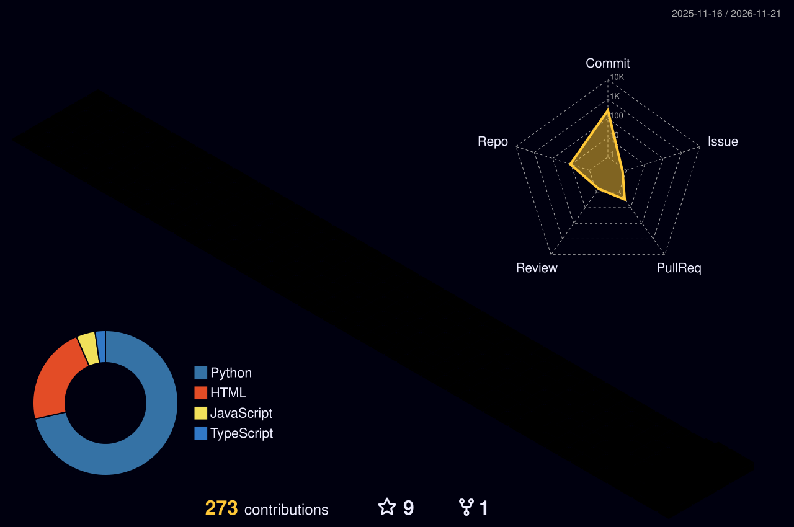

<!-- Save this as README.md in a repo named exactly like your username: github.com/shatwiks/shatwiks -->

<div align="center">


<a href="https://git.io/typing-svg">
  
</a>

<br/>


<a href="https://www.linkedin.com/in/shatwik-sarthak-b6121b2a6/"></a>
<a href="mailto:shatwik7@gmail.com"></a>
<a href="https://github.com/shatwiks"></a>

</div>

---

## ⚡ About Me

B.Tech student in **Computer Science and Engineering at Manipal Institute of Technology (MIT) Bengaluru** (2024 to 2028).
I build systems that stay correct under load: atomic inventory gates, real-time sync, streaming ingestion, and retrieval pipelines that are measured rather than guessed.

- 🏆 **Tech Solstice 48-Hour National Hackathon** finalist, Top 5 of 120+ teams
- ⚙️ Focus: scalable distributed web architectures (Node.js, TypeScript, PostgreSQL, Redis) plus production AI/ML systems (Advanced RAG, model serving, agent workflows)
- 🚀 Building **PolyPulse**, a C++20 + ClickHouse prediction-market orderbook and markout pipeline
- 🎯 Preparing for entry-level SDE and Full-Stack AI/ML roles

---

## 🛠️ Tech Stack

<div align="center">

**Languages & Frontend**


**Backend & Databases**


**Cloud, DevOps & AI**


<br/>


</div>

| Domain | Details |
| :--- | :--- |
| **Distributed Systems** | Redis (Lua scripting, Redlock, Pub/Sub, semantic caching), Saga pattern, idempotency keys, TOCTOU race-condition elimination, eventual consistency, microservices |
| **Data Pipelines & Streaming** | WebSocket ingestion, deduplication and replay recovery, dead-letter handling, ClickHouse materialized views and ASOF joins, SSE |
| **AI & ML** | RAG, agentic AI, prompt engineering, dense embeddings, Cohere Rerank, Ragas, DeepEval |
| **Testing & Practices** | PyTest, Jest, k6 load testing, observability, Agile (Scrum, Kanban), conventional commits |
| **AI-Assisted Development** | GitHub Copilot, Claude Code, Cline, Aider |

---

## 📊 Top Skills (measured from my repos)

*Measured by non-blank lines of project code and manifest dependencies across 10 public repositories (161k+ lines).*

**Languages**

```text
Python      ████████████████████░░░░░░░░░░░░░░░░░░░░  49.2%  · 79.2k lines · 6 repos
TypeScript  █████████████████░░░░░░░░░░░░░░░░░░░░░░░  42.4%  · 68.3k lines · 9 repos
JavaScript  ██░░░░░░░░░░░░░░░░░░░░░░░░░░░░░░░░░░░░░░   4.0%  ·  6.4k lines · 6 repos
CSS         █░░░░░░░░░░░░░░░░░░░░░░░░░░░░░░░░░░░░░░░   2.8%  ·  4.5k lines · 10 repos
C++20       █░░░░░░░░░░░░░░░░░░░░░░░░░░░░░░░░░░░░░░░   0.8%  ·  1.3k lines · 1 repo
SQL         █░░░░░░░░░░░░░░░░░░░░░░░░░░░░░░░░░░░░░░░   0.7%  ·  1.2k lines · 8 repos
```

**Most-used frameworks & infrastructure** *(number of repos)*

| Frontend | Backend | Data & Infra |
| :--- | :--- | :--- |
| ⚛️ React · **9** | ⚡ FastAPI · **6** | 🐳 Docker · **9** |
| 🎨 Tailwind CSS · **6** | 🧱 SQLAlchemy + Pydantic · **5** | 🐘 PostgreSQL · **8** |
| ▲ Next.js · **5** | 🚂 Express · **4** | ⚙️ GitHub Actions CI · **6** *(+ profile)* |
| ⚡ Vite · **5** | 🛠️ Alembic · **4** | 🟥 Redis · **5** |
| 🧊 Three.js · **2** | 🧪 pytest · **4** *(+ Vitest · 2)* | 🧭 pgvector · **3** *(+ SQLite · 2)* |
| 🐻 Zustand · **2** | 🛡️ Zod · **3** *(+ Prisma · 2)* | ☸️ Terraform · **2** *(+ K8s · 1)* |

---

## 🚀 Featured Projects

*All 10 built projects across distributed systems, applied AI, cloud-native infrastructure, and full-stack engineering — ranked by systems depth and recruiter impact.*

### 1. [AegisOps — Autonomous AIOps & Self-Healing Kubernetes Control Plane](https://github.com/shatwiks/AegisOps)
Locally runnable AIOps control plane and Kubernetes operator that scrubs PII fail-closed (`1.00` precision/recall), maps CMDB blast radius, retrieves runbooks via `pgvector` + Ollama hybrid RAG, and enforces Keycloak OIDC + TOTP MFA approval or deterministic refusal before proving 60s of unbroken recovery.
Verified with **65/65** pytest tests (unit, live K8s/DB integration, Playwright E2E), **240/240** `k6` burst checks (`0.00%` failed), **4/4** live `kind` chaos recoveries + stateful DB refusal, Ruff/Mypy clean across 50 Python modules, and GitHub Actions CI.
**Stack:** `Python 3.12` · `FastAPI` · `Kubernetes (kind)` · `Terraform` · `PostgreSQL 16` · `pgvector` · `Redis` · `Keycloak` · `Ollama` · `React 18`

### 2. [PolyPulse — Cross-Venue Prediction-Market Orderbook & Markout Pipeline](https://github.com/shatwiks/polypulse)
Fixed-point C++20 orderbook engine (`std::vector<PriceLevel>`, zero steady-state heap allocations) paired with Python AsyncIO Polymarket/Kalshi/Polygon ingestion, SQLite WAL journaling, ClickHouse `LEFT ASOF JOIN` 5s/30s/60s markout, and official fee-schedule arbitrage scanning.
Benchmarked at **56.39M ops/sec** (**17.00 ns** p50) for in-place level updates and **13.53M ops/sec** AVX2 batch VWAP; verified with **133** passing Python tests, C++20 unit assertions, Vite build (`1,578` modules), and GitHub Actions CI.
**Stack:** `C++20` · `Python` · `FastAPI` · `ClickHouse` · `SQLite WAL` · `React 19` · `Web Workers` · `Docker Compose`

### 3. [Distributed Flash-Sale Engine — High-Throughput Ticket Booking Architecture](https://github.com/shatwiks/distributed-flash-sale-engine)
High-concurrency ticketing engine eliminating TOCTOU race conditions and overselling via $O(1)$ Redis Lua atomic reservation gates, Redlock distributed locks, two-phase compensating `INCRBY` saga rollbacks, and AWS ECS Fargate + Terraform IaC.
Sustains **10,000+ RPS** burst traffic with **0.00% overbooking**, **18.5 ms** p95 latency (93.2% lower than 271 ms `SELECT ... FOR UPDATE`), and **0.00% HTTP 500** errors versus 18.4% relational pool exhaustion, paired with a Next.js 16 concurrency duel UI.
**Stack:** `Node.js 20` · `Express` · `TypeScript` · `Next.js 16` · `Redis 7 (Lua)` · `PostgreSQL 16` · `AWS ECS` · `Terraform` · `k6`

### 4. [Bastion — Zero-Leak Multi-Tenant Hybrid RAG Engine](https://github.com/shatwiks/Bastion-hybrid-rag)
Multi-tenant RAG platform executing pre-retrieval JWT `tenant_id` + `allowed_roles` SQL CTE filtering before `pgvector` HNSW + dual-FTS (`simple`/`english`) Reciprocal Rank Fusion, a `< 0.65` Cross-Encoder refusal gate (`0` LLM tokens on traps), and Redis 8 scoped semantic caching.
Benchmarked at **100.0% retrieval precision** and **1.0000 MRR** (+32.59% lift) across 28 probes, **0.0% ungrounded answers** and **0/14** RBAC/tenant leaks on adversarial traps, Ragas v0.4 evaluation, and a Next.js 16 landing + live `/workspace` SSE inspector.
**Stack:** `Python 3.12` · `FastAPI` · `PostgreSQL 17` · `pgvector` · `Redis 8` · `Next.js 16` · `React 19` · `Ragas` · `Docker`

### 5. [PayGuard AI — Agentic Payment Dispute Triage & Regulatory RAG Engine](https://github.com/shatwiks/PayGuard-AI-Agentic-Payment-Triage-RAG-Engine)
Autonomous payment triage platform (`27.8k+` non-blank LOC, 18 API routes, 6 Alembic migrations) combining a strictly read-only 5-tool `ToolRegistry`, gateway-timeout non-mutation semantics, and prompt-injection defense with hybrid `pgvector` + FTS RAG over Visa/Mastercard/NACHA rules.
Includes **207 test cases** across 20 modules (**181/181** independently audited pass), **40/40 (100%)** Ollama RAG evaluation (`100%` Recall@5, `1.0000` MRR, `100%` tenant isolation), **8/8** Playwright E2E tests, Docker staging `pg_dump`/`pg_restore` verification, and CI.
**Stack:** `Python 3.14` · `FastAPI` · `PostgreSQL 16` · `pgvector` · `Next.js 15` · `React 19` · `SQLAlchemy` · `Playwright` · `Docker`

### 6. [GlamGo — Beauty Retail Marketplace & Instant Booking Platform](https://github.com/shatwiks/Glamgo) • [Live Demo](https://glamgo-ricoz.vercel.app/) • [API Docs](https://glamgo-backend-lqn6.onrender.com/docs)
Production-deployed multi-vendor commerce and salon/at-home booking platform with integer-paise largest-remainder order splitting, row-locked `SellerListing` stock reservations, Razorpay HMAC-SHA256 webhook reconciliation, T+7 seller escrow, HTTP 409 double-booking guards, and immutable DB audit triggers.
Verified with **78/78** local pytest tests against PostgreSQL 16 + Redis 7 (**62/62** in 3-stage GitHub Actions CI), **7.3x** faster warm catalog endpoints (`0.30s`), Playwright desktop/mobile E2E checks (`0` errors, `0px` overflow), and live Vercel + Render deployments.
**Stack:** `Python` · `FastAPI` · `PostgreSQL 16` · `Redis 7` · `Vite` · `Razorpay` · `Playwright` · `Docker`

### 7. [RicozViz — Enterprise BI & Analytical Exploration Platform](https://github.com/shatwiks/ric0fc) • [Live Demo](https://ricozviz.vercel.app)
Dual-storage SaaS BI platform pairing DuckDB for sub-second analytical file queries with PostgreSQL for multi-tenant transactional metadata, strict server-side RBAC, schema-allowlisted query generation, and 192-bit cryptographic dashboard share tokens.
Verified with **42/42** security audit tests, **13/13** static architectural checks, **10/10** Playwright security tests, **12/12** E2E pages with zero console/network errors, and live Vercel + Render/Supabase deployment configuration.
**Stack:** `DuckDB` · `PostgreSQL` · `FastAPI` · `Python` · `Next.js` · `TypeScript` · `Three.js` · `Playwright` · `Docker`

### 8. [StockPulse — Multi-Tenant Inventory & POS Order Engine](https://github.com/shatwiks/StockPulse-Multi-Tenant-Inventory-Order-Engine)
B2B multi-tenant inventory and POS order engine eliminating PostgreSQL `40P01` deadlocks via deterministic `ORDER BY id ASC FOR UPDATE` lock ordering, `stock_quantity >= 0` check constraints, Indian GST bifurcation, and a Three.js 3D warehouse telemetry console.
Verified with automated 10-thread parallel stress tests (`0` negative-stock drift), GitHub Actions CI with ephemeral PostgreSQL migrations, and an AST accessibility audit certifying **100% WCAG 2.1 AA** compliance across 19 UI components.
**Stack:** `TypeScript` · `Next.js 16` · `React 19` · `Express` · `PostgreSQL 16` · `Prisma` · `Three.js` · `Docker Compose`

### 9. [OrderFlow — Multi-Restaurant Commerce & Real-Time Fulfillment Engine](https://github.com/shatwiks/Real-Time-Commerce-and-Web-Application-Platform)
Multi-restaurant ordering and kitchen fulfillment platform enforcing database-authoritative billing transactions, SHA-256 step-up 2FA OTP with atomic 3-attempt burn, and room-scoped Socket.io updates (`order:<id>`, `restaurant:<id>`).
Backed by an automated GitHub Actions CI pipeline running Prisma schema migrations on PostgreSQL 15, strict TypeScript checks, and Vitest + Supertest security tests.
**Stack:** `TypeScript` · `Node.js` · `Express` · `React 19` · `Socket.io` · `Prisma` · `PostgreSQL 15` · `Vitest` · `Docker`

### 10. [MedicineLink — Surplus Medicine Redistribution Platform](https://github.com/shatwiks/Medicine-Link)
Academic healthcare redistribution prototype pairing Tesseract.js OCR + Sharp blister-pack intake with a 12-factor clinical eligibility engine, Haversine proximity matching, cryptographic QR tracking, and native SQLite WAL persistence.
Built with full-stack TypeScript across 15 relational tables with partial unique first-accept concurrency guards (`ux_matches_one_accepted`), immutable audit triggers, Swagger OpenAPI docs, and passing Vitest suites.
**Stack:** `TypeScript` · `React 18` · `Node.js` · `Express` · `SQLite (WAL)` · `Zod` · `Tesseract.js` · `Vitest`
---

## 🏆 Hackathons & Achievements

**Team Lead & National Finalist, Tech Solstice 48-Hour Hackathon** • Bengaluru • March 2026 • *Top 5 of 120+ teams*

- Led the build of **DisasterSync**, an offline-first disaster coordination and reporting system, from concept to working product in 48 hours
- Local mesh synchronization with WebSockets, WebRTC and IndexedDB, auto-syncing stored telemetry to cloud PostgreSQL once connectivity returns
- Real-time status dashboards and automated alert triage for field teams

**Certifications & more**

- 🎓 Supervised Machine Learning: Regression and Classification (DeepLearning.AI / Coursera)
- 🎓 Generative AI, LLMs, RAG & Prompt Engineering Foundations
- 🧩 200+ DSA, OOP and SQL problems solved on LeetCode and HackerRank
- 🤝 Active contributor to campus coding and AI/ML societies at MIT Bengaluru

---

## 📊 GitHub Stats

<div align="center">


<br/>


<br/>


</div>

### 🧊 3D Contribution Graph

<div align="center">
  
</div>

### 🐍 Contribution Snake

<div align="center">
  <picture>
    <source media="(prefers-color-scheme: dark)" srcset="https://raw.githubusercontent.com/shatwiks/shatwiks/output/github-contribution-grid-snake-dark.svg" />
    
  </picture>
</div>

---

## 🧠 Engineering Principles

- **Systems over wrappers:** resilient background queues, distributed caches and streaming protocols instead of brittle synchronous API calls
- **Deterministic AI:** guarding non-deterministic LLM behavior with strict schema validation (Pydantic/Zod), context-precision scoring and automated hallucination tests in CI
- **Clean code & Git hygiene:** semantic commits (`feat:`, `fix:`, `refactor:`), READMEs with architecture diagrams, reproducible Docker configs

## 🎯 Currently Focused On

- Low-latency data systems: streaming ingestion, orderbooks and real-time analytics
- Advanced algorithms across graphs, dynamic programming and low-level design
- Contributing to open-source agentic frameworks and local model inference engines

---

<div align="center">

### 📫 Let's connect

<a href="https://www.linkedin.com/in/shatwik-sarthak-b6121b2a6/"></a>
<a href="mailto:shatwik7@gmail.com"></a>
<a href="https://github.com/shatwiks"></a>


</div>
